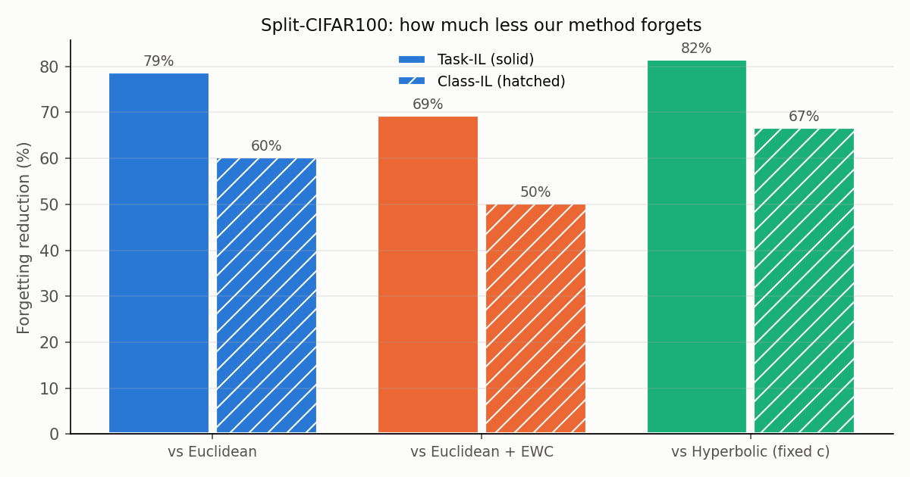
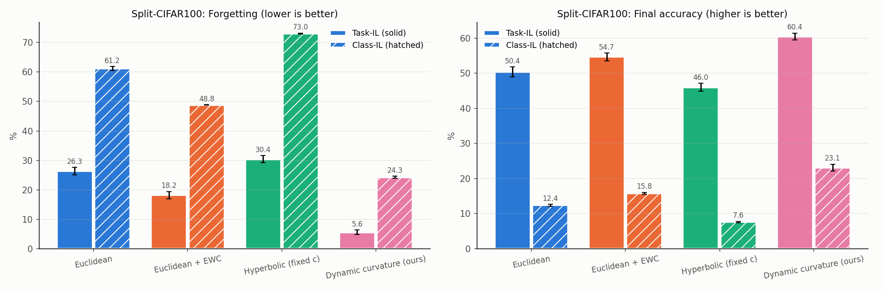
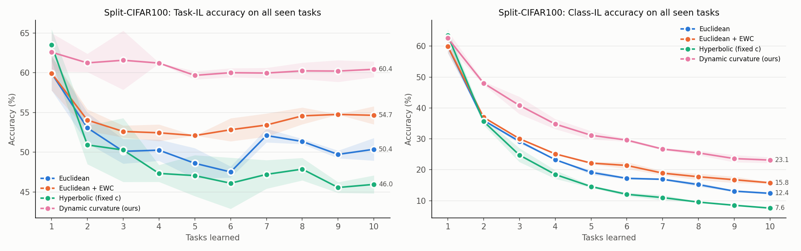
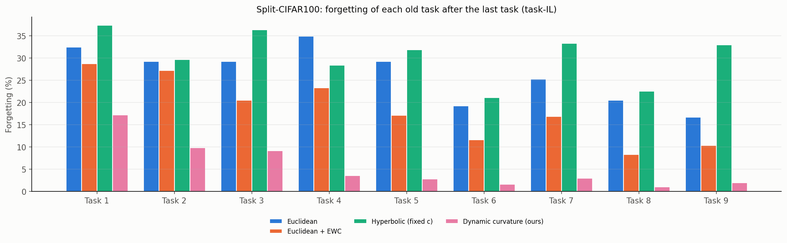
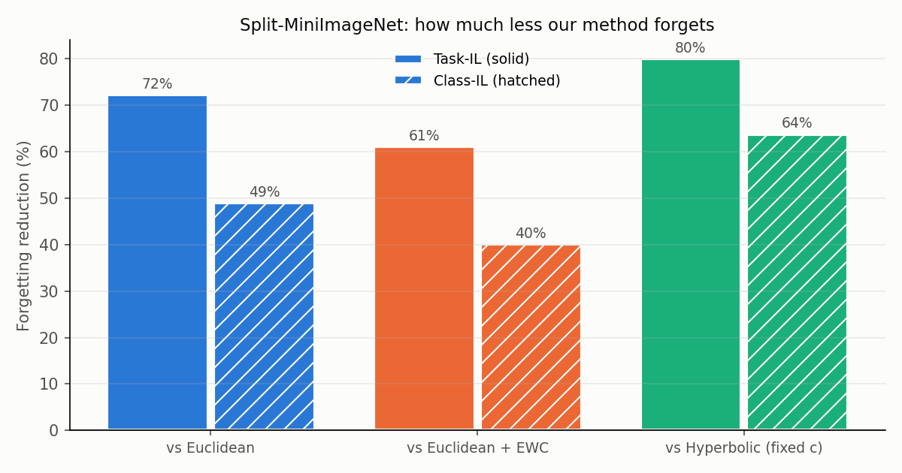
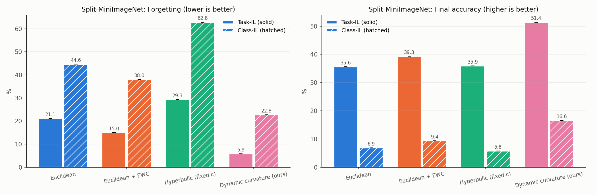
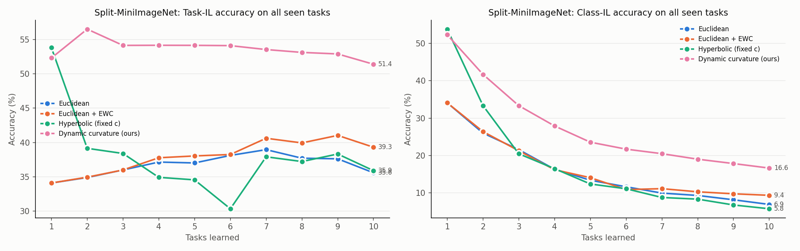
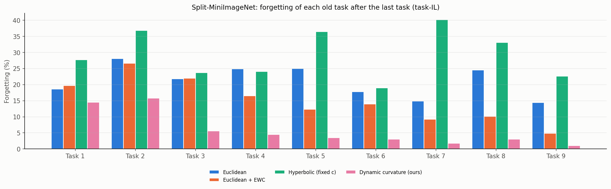

# Dynamic-Curvature Hyperbolic Continual Learning

Mitigating catastrophic forgetting with **learnable-curvature hyperbolic prototypes**. We compare our
method with Euclidean, Euclidean + EWC and HMCL-style fixed-curvature baselines on
**Split-CIFAR100** and **Split-MiniImageNet**: real data, class-incremental, 10 tasks × 10 classes,
**zero replay**, every model trained **from scratch** (no pretrained weights).

## Hypothesis

Volume in hyperbolic space grows exponentially with radius, while in Euclidean space it grows only
polynomially. We test the hypothesis that this extra room **may** reduce interference between the
classes of different tasks, and whether **learning the curvature** helps beyond a fixed curvature. We
evaluate this against our own fixed-curvature hyperbolic baseline under identical data, encoder,
training and evaluation, rather than relying on claims about other systems.

## Key results

On both benchmarks, **Dynamic curvature (ours)** has the lowest forgetting **and** the highest accuracy:

| | Split-CIFAR100 (2 seeds) | Split-MiniImageNet (1 seed) |
|---|---|---|
| Task-IL forgetting vs Euclidean + EWC | 18.24 → **5.59** (69% less) | 15.03 → **5.86** (61% less) |
| Class-IL forgetting vs Euclidean + EWC | 48.81 → **24.28** (50% less, p = 0.011) | 38.04 → **22.78** (40% less) |
| Task-IL accuracy vs Euclidean + EWC | 54.65 → **60.45** (+5.8 pts) | 39.31 → **51.39** (+12.1 pts) |
| Class-IL accuracy vs Euclidean + EWC | 15.79 → **23.14** (+7.4 pts) | 9.35 → **16.63** (+7.3 pts) |

<!-- RESULTS:START -->

## Results (GPU, full Split benchmarks)

> GPU run (Tesla T4): Split-CIFAR100 (10 epochs, seeds 0 and 1) and Split-MiniImageNet (4 epochs, seed 0),
> 10 tasks × 10 classes, all 5,000 train / 1,000 test images per task, encoder width 64, real data,
> zero replay. The full run, with every output, is in
> [`results/gpu/gpu_run_notebook.ipynb`](results/gpu/gpu_run_notebook.ipynb)
> ([PDF](results/gpu/gpu_run_notebook.pdf)).

**Metrics:** *accuracy* = average accuracy over all 10 tasks after the last task; *forgetting* =
best − final accuracy on old tasks (lower is better); **task-IL** = task id given at test time,
**class-IL** = no task id (harder). Values are mean ± std over seeds; p-values are paired t-tests on
forgetting (they need 2 or more seeds).

### Split-CIFAR100

**Results** (mean ± std over 2 seeds)

| Method | Seeds | Task-IL acc | Task-IL forgetting | Class-IL acc | Class-IL forgetting | Curvature c |
|---|---|---|---|---|---|---|
| Euclidean | 2 | 50.38 ± 1.43 | 26.34 ± 1.29 | 12.39 ± 0.33 | 61.21 ± 0.71 | — |
| Euclidean + EWC | 2 | 54.65 ± 1.14 | 18.24 ± 1.22 | 15.79 ± 0.28 | 48.81 ± 0.05 | — |
| Hyperbolic (fixed c) | 2 | 45.96 ± 1.13 | 30.43 ± 1.23 | 7.60 ± 0.21 | 73.03 ± 0.19 | 0.100 → 0.100 |
| **Dynamic curvature (ours)** | 2 | 60.45 ± 0.98 | 5.59 ± 0.81 | 23.14 ± 0.96 | 24.28 ± 0.38 | 0.097 → 0.089 |

**How much better is Dynamic curvature (ours)?**

| Compared with | Setting | Forgetting (baseline → ours) | Forgetting reduction | Accuracy (baseline → ours) | Accuracy gain | p-value (forgetting) |
|---|---|---|---|---|---|---|
| Euclidean | Task-IL | 26.34 → 5.59 | **79% less** | 50.38 → 60.45 | +10.07 pts (+20%) | 0.0642 |
| Euclidean | Class-IL | 61.21 → 24.28 | **60% less** | 12.39 → 23.14 | +10.76 pts (+87%) | 0.0057 |
| Euclidean + EWC | Task-IL | 18.24 → 5.59 | **69% less** | 54.65 → 60.45 | +5.80 pts (+11%) | 0.1010 |
| Euclidean + EWC | Class-IL | 48.81 → 24.28 | **50% less** | 15.79 → 23.14 | +7.35 pts (+47%) | 0.0111 |
| Hyperbolic (fixed c) | Task-IL | 30.43 → 5.59 | **82% less** | 45.96 → 60.45 | +14.49 pts (+32%) | 0.0520 |
| Hyperbolic (fixed c) | Class-IL | 73.03 → 24.28 | **67% less** | 7.60 → 23.14 | +15.54 pts (+204%) | 0.0075 |









### Split-MiniImageNet

**Results** (1 seed)

| Method | Seeds | Task-IL acc | Task-IL forgetting | Class-IL acc | Class-IL forgetting | Curvature c |
|---|---|---|---|---|---|---|
| Euclidean | 1 | 35.59 | 21.11 | 6.91 | 44.59 | — |
| Euclidean + EWC | 1 | 39.31 | 15.03 | 9.35 | 38.04 | — |
| Hyperbolic (fixed c) | 1 | 35.90 | 29.30 | 5.75 | 62.80 | 0.100 → 0.100 |
| **Dynamic curvature (ours)** | 1 | 51.39 | 5.86 | 16.63 | 22.78 | 0.098 → 0.086 |

**How much better is Dynamic curvature (ours)?**

| Compared with | Setting | Forgetting (baseline → ours) | Forgetting reduction | Accuracy (baseline → ours) | Accuracy gain | p-value (forgetting) |
|---|---|---|---|---|---|---|
| Euclidean | Task-IL | 21.11 → 5.86 | **72% less** | 35.59 → 51.39 | +15.80 pts (+44%) | n/a (1 seed) |
| Euclidean | Class-IL | 44.59 → 22.78 | **49% less** | 6.91 → 16.63 | +9.72 pts (+141%) | n/a (1 seed) |
| Euclidean + EWC | Task-IL | 15.03 → 5.86 | **61% less** | 39.31 → 51.39 | +12.08 pts (+31%) | n/a (1 seed) |
| Euclidean + EWC | Class-IL | 38.04 → 22.78 | **40% less** | 9.35 → 16.63 | +7.28 pts (+78%) | n/a (1 seed) |
| Hyperbolic (fixed c) | Task-IL | 29.30 → 5.86 | **80% less** | 35.90 → 51.39 | +15.49 pts (+43%) | n/a (1 seed) |
| Hyperbolic (fixed c) | Class-IL | 62.80 → 22.78 | **64% less** | 5.75 → 16.63 | +10.88 pts (+189%) | n/a (1 seed) |









<!-- RESULTS:END -->

## What the results do and do not show

- Our method forgets less and is more accurate than all three baselines on both benchmarks.
- The fixed-curvature hyperbolic baseline forgets **more** than the Euclidean one, so hyperbolic
  geometry on its own is not enough.
- In a small pilot ablation (reduced setting, one seed), the same recipe with a Euclidean head was less
  accurate and forgot more than with the hyperbolic head, and drift compensation and the Fisher penalty
  gave the largest gains.
- The learned curvature stayed close to its starting value of 0.1 (about 0.09 at the end), and the
  frozen-curvature ablation (`ablation-fixed-curvature`) has not been run yet, so the effect of the
  *dynamic* curvature is not isolated.

## Methods

All methods share the same encoder (a reduced ResNet-18 trained from scratch, GroupNorm), data
stream, optimiser and evaluation. They differ only in the head and the forgetting protection.

| Name | Method |
|---|---|
| `euclidean` | Euclidean prototype classifier, no protection (lower bound) |
| `ewc` | Euclidean + Elastic Weight Consolidation (Kirkpatrick et al., 2017) |
| `hmcl` | Lorentz head with **fixed** curvature + covariance gradient projection + head pullback (HMCL-style, adapted to end-to-end training) |
| **`dynamic-curvature`** (ours) | Lorentz head with **learnable** curvature + Fisher protection of the encoder + prototype drift compensation (SDC, Yu et al., 2020) + old-class prototypes as negatives with prototype augmentation (PASS, Zhu et al., 2021) |
| `ablation-euclidean` (optional) | our recipe with a Euclidean head: does the geometry matter? |
| `ablation-fixed-curvature` (optional) | our recipe with frozen curvature: does the *dynamic* curvature matter? |

Only one prototype and one radius per class are stored; no images are replayed.

## Setup and how to run (Google Colab, GPU)

1. Open **`results/gpu/gpu_run_notebook.ipynb`** in Colab: *File → Open notebook → GitHub*, enter
   `Tarungowdap/HUBERILT-HMCL_ICML` and pick the notebook. It is the exact run reported above, with
   all outputs; running it again reproduces the results.
2. **Runtime → Change runtime type → T4 GPU** (or better).
3. Kaggle API token: kaggle.com → *Settings → API → Create New Token*. In Colab's left sidebar open
   **🔑 Secrets**, add `KAGGLE_USERNAME` and `KAGGLE_KEY`, and switch on *Notebook access*
   (if they are missing, Setup asks for them).
4. Run the cells in order:

| Step | What it does |
|---|---|
| Setup | Mount Drive, clone this repo, read the Kaggle key, check the GPU |
| 1. Load the datasets | CIFAR-100 and MiniImageNet from Kaggle → 10 tasks × 10 classes each (cached in Drive) |
| 2. Train all methods | Euclidean, Euclidean + EWC, Hyperbolic (fixed c), Dynamic curvature (ours) on both benchmarks, all seeds (resumable), then keep the seeds every method finished |
| 3. Benchmarks | Tables (mean ± std, % improvement, p-values) and all charts |

Results are saved to `MyDrive/hmcl_results_gpu/<dataset>/` after every run, so if Colab disconnects,
run Setup and Step 1 again and the training continues where it stopped. Measured on a T4, per seed,
for all 4 methods: roughly 15–20 min for Split-CIFAR100 (10 epochs) and 29 min for Split-MiniImageNet
(4 epochs).

### Command line (any machine with a GPU)

```bash
pip install -r requirements.txt
```
```bash
export KAGGLE_USERNAME=... KAGGLE_KEY=...
```
```bash
python run_benchmark.py --dataset split_cifar100 --seeds 0 1 --epochs 10 --amp 1
```
```bash
python run_benchmark.py --dataset split_miniimagenet --img-size 64 --seeds 0 --epochs 4 --amp 1
```

`python run_benchmark.py --help` lists every option.

### Regenerate the tables and charts

```bash
python make_report.py --results /content/drive/MyDrive/hmcl_results_gpu --out results/gpu --readme README.md
```

This rebuilds every table and chart from the saved result files and replaces the *Results (GPU)*
section of this README.

## Repository layout

```
run_benchmark.py           command-line entry point
make_report.py             saved results -> tables, % improvement, p-values, charts, README
hmcl_cl/
  data.py                  Kaggle download, task streams, GPU augmentation
  geometry.py              Lorentz model: distances, Lorentz linear layer, learnable curvature, drift
  models.py                encoder and Euclidean / hyperbolic heads
  regularizers.py          EWC and HMCL-style gradient projection
  train.py                 training loop, evaluation, metrics, all methods
results/gpu/               the GPU run: Colab notebook with outputs (main entry point), PDF, tables, charts
tests/                     unit tests (pytest)

```

## Data

- CIFAR-100: Kaggle `fedesoriano/cifar100` (official 50,000 / 10,000 split).
- MiniImageNet: Kaggle `arjunashok33/miniimagenet` (100 classes × 600 images, resized to 64×64).
  There is no test split, so a fixed 1/6 of each class (100 images) is held out for testing.
- Class order is a fixed random permutation per seed, identical for all methods.

## Tests

```bash
pytest
```
